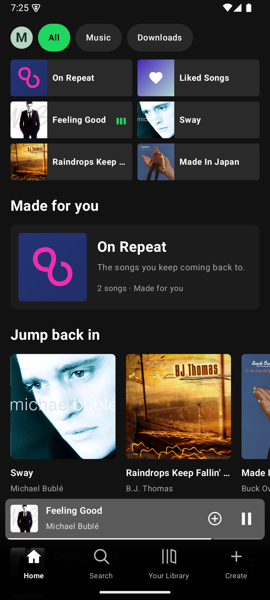
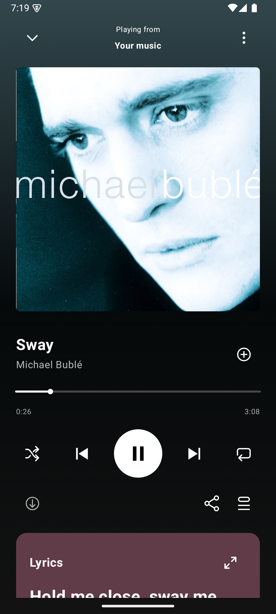
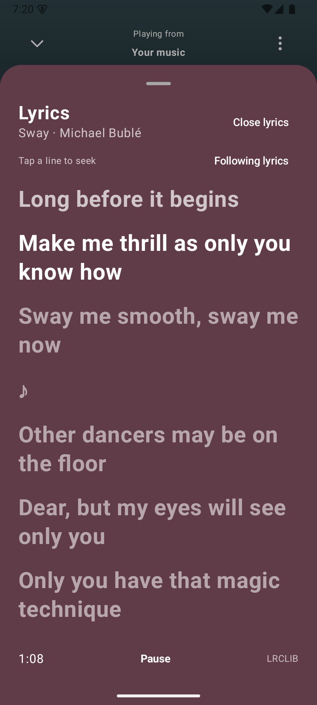
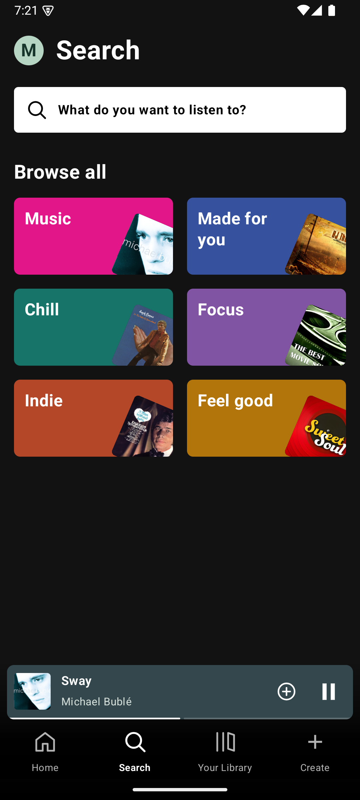
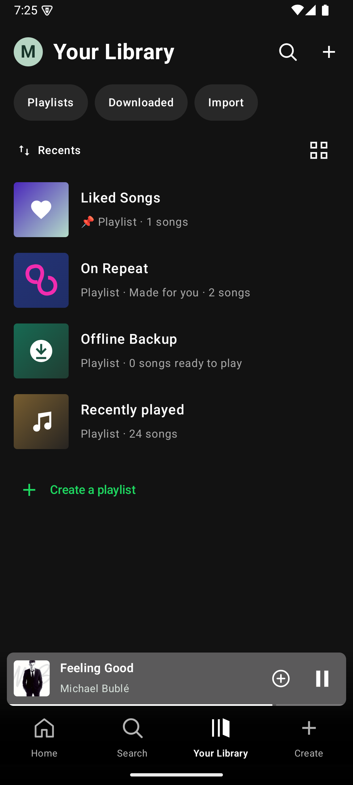
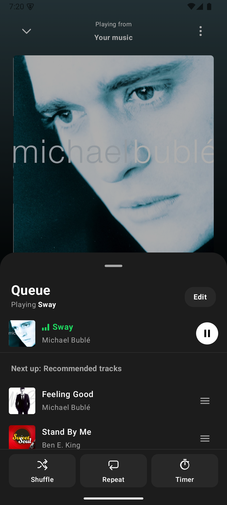
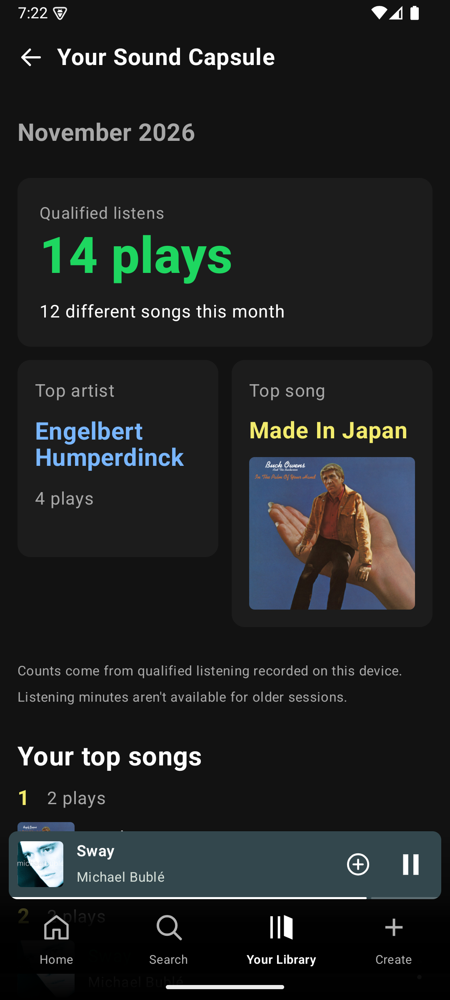

<div align="center">


# Spokify

**A native Android music streaming and offline player built with Kotlin, Jetpack Compose, Media3, and Room.**

Search tracks, build local playlists, import public Spotify and YouTube playlists without logging in, follow synced lyrics, track your monthly Sound Capsule stats, and keep music cached for offline playback.

[](https://github.com/Mitanshp5/Spokify/releases/latest/download/spokify.apk)
[](https://github.com/Mitanshp5/Spokify/releases/latest)
[-3DDC84?style=for-the-badge&logo=android&logoColor=black)](android/app/build.gradle.kts)
[](android/LICENSE)

[Features](#features) • [Screenshots](#screenshots) • [Architecture & Stack](#architecture--tech-stack) • [Install & Updates](#install-and-updates) • [Build](#build-from-source) • [Release](#publish-an-update) • [Privacy & Notices](#privacy--third-party-notices)

</div>

---

## Screenshots

### Playback, Player & Synced Lyrics

<table>
  <tr>
    <td align="center" width="33%">
      
      <br />
      <sub><strong>Home</strong><br />Filter pills, 2-column shortcuts, On Repeat, Jump back in, and swipeable Mini Player</sub>
    </td>
    <td align="center" width="33%">
      
      <br />
      <sub><strong>Now Playing</strong><br />Dynamic artwork color extraction, scrub bar, quick actions, and live Lyrics card</sub>
    </td>
    <td align="center" width="33%">
      
      <br />
      <sub><strong>Synced Lyrics</strong><br />Time-synced LRC highlighting via LRCLIB with tap-any-line playback seeking</sub>
    </td>
  </tr>
</table>

### Search, Library & Endless Queue

<table>
  <tr>
    <td align="center" width="33%">
      
      <br />
      <sub><strong>Search &amp; Browse</strong><br />Music catalog search, recent search history, and category shortcuts</sub>
    </td>
    <td align="center" width="33%">
      
      <br />
      <sub><strong>Your Library</strong><br />Liked Songs, On Repeat, Offline Backup, local playlists, and playlist importer</sub>
    </td>
    <td align="center" width="33%">
      
      <br />
      <sub><strong>Queue &amp; Radio</strong><br />Neighbourhood Radio recommendations, drag-to-reorder editing, and Sleep Timer</sub>
    </td>
  </tr>
</table>

---

## Features

### Audio Search & SABR Streaming
- **Music-focused catalog search** powered by the vendored `third_party/extractor` library filtered to `music_songs`, backed by an expiry-aware `AudioResolutionCache` so Media3 seeks and lookahead buffering avoid redundant resolution requests.
- **Android Reel playback & SABR transport** via `ReelPlaybackResolver` and a custom Media3 `SabrRoutingDataSourceFactory` (`SabrDataSource`, `UmpReader`, `SabrSegmentAssembler`) with throttling-parameter deobfuscation.
- **Responsive Now Playing UX** featuring swipe gestures on the Mini Player for track navigation, adaptive gradient backgrounds sampled from album artwork, collapsing mini-header while scrolling through lyrics, and `MediaSessionService` notification controls.

### Neighbourhood Radio & Personalized Queue Mixer
- **Hybrid discovery radio**: blends YouTube Music `WEB_REMIX` automix (`SongRadioRepository`) with `NeighbourhoodRadio` collaborative-filtering lookups across MusicBrainz and ListenBrainz Labs (`similar-recordings` and `similar-artists`).
- **Client-side ranking (`SongRadioMixer`)**: promotes your liked and frequently completed tracks while gently demoting early skips without permanently hiding artists or tracks. Enforces artist spacing and window caps (`ARTIST_WINDOW = 10`, `ARTIST_WINDOW_CAP = 2`, `SPACING_WINDOW = 2`).
- **Flexible Queue & Sleep Timer**: edit and reorder Up Next tracks, toggle Shuffle or Repeat (`Off` / `All` / `One`), or set a Sleep Timer for a countdown duration or **end of current song**.

### Synced & Plain Lyrics (`LRCLIB`)
- Fetches timestamped `.lrc` synced lyrics and plain-text fallbacks from [LRCLIB](https://lrclib.net).
- Highlights the active line automatically during playback and supports **tap-to-seek** to jump straight to any lyric line.
- Caches successful responses atomically on disk keyed by SHA-256, never caching transient network failures.

### Offline Backup & Storage-Budgeted Auto-Downloads
- Powered by Media3's persistent `DefaultDownloadIndex` and a dedicated `SimpleCache` inside app storage (`filesDir` with `NoOpCacheEvictor`) using stable `sidea-track` URIs instead of short-lived stream URLs.
- **Manual vs. Automatic ownership**: manually saved songs stay until you delete them, while automatic downloads cache songs you replay (`3+` qualified listens) inside a configurable storage budget (default **500 MiB**, max 25 tracked items) with an optional metered-network toggle.
- Album artwork is persisted alongside offline tracks via `OfflineArtworkStore` and loaded through Coil 3's `OfflineArtworkInterceptor`.

### No-Login Public Playlist Importer (Spotify & YouTube)
- Paste any public **Spotify** playlist link/ID or **YouTube / YouTube Music** playlist link/ID — no Spotify account or OAuth login required.
- Spotify links are parsed through public `/embed/playlist/{id}` page metadata and Pathfinder `queryPlaylist` responses (up to **2,000 tracks**), then scored against YouTube Music candidates (`scoreSpotifyCandidate`) for title/artist match, duration closeness (±30s tolerance), and version consistency.
- Unclear tracks are flagged as **Review** or **Missing** in an interactive review flow (`ImportScreen`) so you can inspect or pick an alternate match before saving the playlist locally.

### On-Device Sound Capsule, On Repeat & Quiet Listening

<table>
  <tr>
    <td valign="top">
      <ul>
        <li><strong>Qualified Listening Sessions</strong>: <code>ListeningSession</code> tracks actual forward playback progression while ignoring paused gaps, seeks, and network stalls.</li>
        <li><strong>Your Sound Capsule</strong>: monthly breakdown of qualified listens, unique tracks explored, Top Artist, Top Song, and top-played list stored purely on your device in Room (<code>side-a.db</code>).</li>
        <li><strong>On Repeat Mix</strong>: automatically curates up to 30 of your most-replayed tracks over a rolling 30-day window.</li>
        <li><strong>Quiet Notifications</strong> <em>(Android 10+ / API 29+)</em>: optionally activates a Spokify-owned <code>AutomaticZenRule</code> during audible playback without touching your global Do Not Disturb settings.</li>
      </ul>
    </td>
    <td align="center" width="260">
      
    </td>
  </tr>
</table>

---

## Architecture & Tech Stack

| Component | Technology / Details |
| :--- | :--- |
| **Language** | Kotlin `2.4.21` (JVM target `17`, Coroutines `1.11.0`) |
| **UI** | Jetpack Compose (BOM `2026.09.00`), Material 3 (`1.5.0-beta01`), Activity Compose `1.13.0` |
| **Playback & Offline** | AndroidX Media3 `1.11.1` (ExoPlayer, MediaSession, DataSource, Offline `DownloadManager`) |
| **Database** | Room `2.8.5` (SQLite schema v5, KSP `2.3.12`) |
| **Networking & Media** | OkHttp `5.5.0`, `nanojson`, Coil 3 `3.6.3`, custom SABR transport |
| **Catalog Extractor** | Vendored `LevyraExtractor:v1.0.0-levyra.10` (`android/third_party/extractor`, GPL-3.0) |
| **Build System** | Gradle `9.8.1`, Android Gradle Plugin `9.4.1`, `minSdk 26` / `targetSdk 37` |

### Package Overview

```text
Spokify/
├── android/
│   ├── app/src/main/java/com/mitansh/sidea/
│   │   ├── MainActivity.kt               # Single-activity Compose host & navigation wiring
│   │   ├── SideAApplication.kt           # Coil 3 offline artwork & extractor initialization
│   │   ├── core/                         # Track models, URL parsers, resolution cache
│   │   ├── data/
│   │   │   ├── history/                  # Playback session timing & history policies
│   │   │   ├── imports/                  # Import coordinator, session persistence, YouTube reader
│   │   │   ├── library/                  # Room database (SideADatabase v5), DAOs, OnRepeatPolicy
│   │   │   ├── lyrics/                   # LRCLIB client & SHA-256 disk cache
│   │   │   ├── offline/                  # Media3 download cache, artwork store, budget policy
│   │   │   ├── radio/                    # Radio preferences store
│   │   │   ├── similar/                  # MusicBrainz & ListenBrainz NeighbourhoodRadio
│   │   │   ├── spotify/                  # Public Spotify embed & Pathfinder playlist parser
│   │   │   └── youtube/                  # Search, ReelPlaybackResolver, SongRadioMixer
│   │   ├── playback/
│   │   │   ├── sabr/                     # SABR protocol, UMP reader, routing DataSource
│   │   │   ├── feedback/                 # Skip/like feedback weights per artist & track
│   │   │   └── PlaybackService.kt        # MediaSessionService, queue & sleep timer
│   │   ├── ui/                           # Compose screens (Home, NowPlaying, Search, Library, Queue, etc.)
│   │   └── updates/                      # GitHub Releases manifest check & APK verification
│   ├── third_party/extractor/            # Vendored LevyraExtractor Gradle composite build
│   ├── LICENSE                           # GNU GPL v3
│   └── THIRD_PARTY_NOTICES.md            # Attribution and source notices
├── docs/screenshots/                     # Emulator showcase screenshots
├── scripts/release.py                    # Verified APK packaging & GitHub Release publisher
└── CHANGELOG.md                          # Version release notes
```

---

## Install and Updates

1. Download [the latest APK (`spokify.apk`)](https://github.com/Mitanshp5/Spokify/releases/latest/download/spokify.apk) on your Android device (Android 8.0 / API 26 or newer) and confirm installation when prompted.
2. Updating an existing install with the same signing key preserves your entire Room library, playlists, listening stats, and offline downloads.
3. **In-app updates**: Spokify checks GitHub Releases (`Mitanshp5/Spokify`) once per calendar day on first app open, or manually anytime via **Settings → App updates** (`Check for updates`).
4. When a newer release is available, a yellow indicator dot appears on your top-bar profile button, on the **Update Spokify** item below **Settings and privacy** in the navigation drawer, and on the **App updates** row in Settings.
5. Before launching Android's package installer, Spokify verifies the downloaded APK's **SHA-256 digest**, package ID (`com.mitansh.sidea`), strictly higher `versionCode`, and matching **signing certificate** (`AppUpdateViewModel`).

---

## Build from Source

### Prerequisites
- **JDK 21** (project bytecode targets JVM 17)
- **Android SDK Platform 37** configured via `ANDROID_HOME` or an untracked `android/local.properties`

### Build & Test Commands

```sh
cd android
./gradlew :app:testDebugUnitTest :app:assembleDebug :app:assemblePerformance
```

On Windows, use `gradlew.bat` instead of `./gradlew`.

- **`debug`**: unoptimized build for local development and testing (`com.mitansh.sidea`).
- **`performance`**: release-optimized build with R8 code & resource shrinking (`-dontobfuscate` in `android/app/proguard-rules.pro` keeps readable Kotlin symbol names for static analysis while stripping unused code and resources), signed with the developer debug key for side-loaded distribution.
- **`release`**: production build type with R8 shrinking enabled.

> **Signing Key Note:** The public update channel checks that incoming updates match the original APK signing certificate (`~/.android/debug.keystore` for `performance` builds). Back up your signing keystore if distributing updates; an APK signed by a different key cannot update an existing installation in place.

---

## Publish an Update

1. Bump `spokify.versionCode` and `spokify.versionName` in `android/gradle.properties` (every release requires a higher `versionCode`).
2. Run unit tests and assemble the `performance` APK.
3. Commit and push the reviewed changes to `main`.
4. Package and publish with Python 3.10+, Android SDK build tools, Java, and an authenticated GitHub CLI (`gh`):

```sh
python scripts/release.py prepare
python scripts/release.py publish --directory android/.work/releases/v0.3.4
```

Pass `--notes path/to/notes.md` to `prepare` to attach release notes without committing temporary note files. `prepare` validates the package ID, non-debuggable flag, and signer SHA-256 fingerprint before producing `spokify.apk` and `spokify-update.json`; `publish` uploads both to a draft release, verifies GitHub's asset SHA-256 digests, and promotes the release to latest.

---

## Privacy & Third-Party Notices

- **All personal data stays local**: your profile name/avatar, playlists, Liked Songs, playback history, Sound Capsule stats, and offline downloads reside solely on your device in Room and app-private storage. No Spokify account or backend server exists.
- **External services contacted**: searches, artwork, stream playback, lyrics, radio enrichment, public playlist imports, and update checks contact their respective public upstream providers (`YouTube / YouTube Music`, `LRCLIB`, `MusicBrainz / ListenBrainz`, `Spotify public playlist embeds`, and `GitHub Releases`).

See [the license (GNU GPL v3)](android/LICENSE), [third-party notices](android/THIRD_PARTY_NOTICES.md), and the [changelog](CHANGELOG.md).
